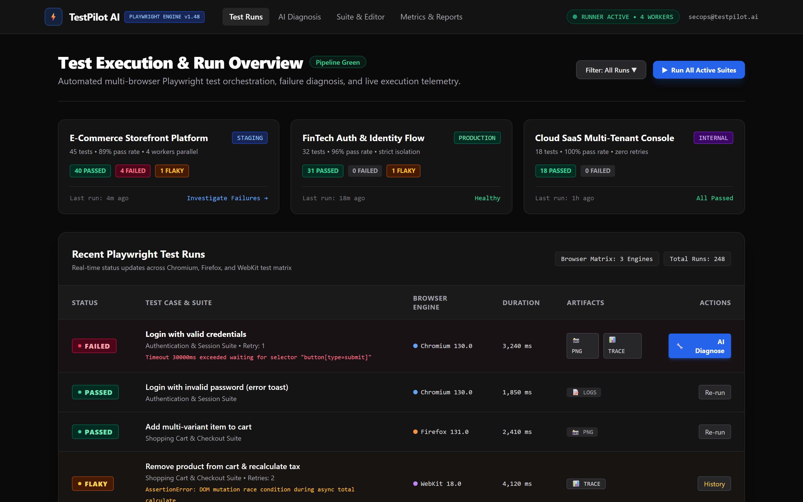
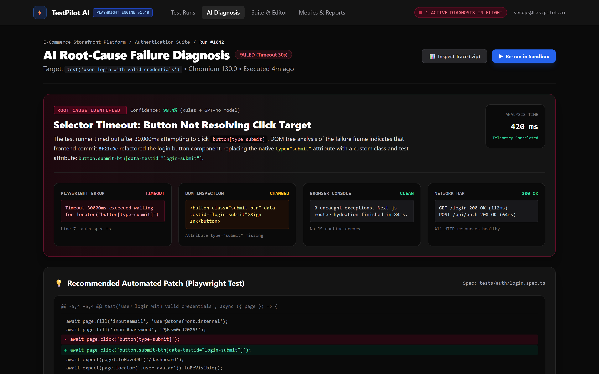
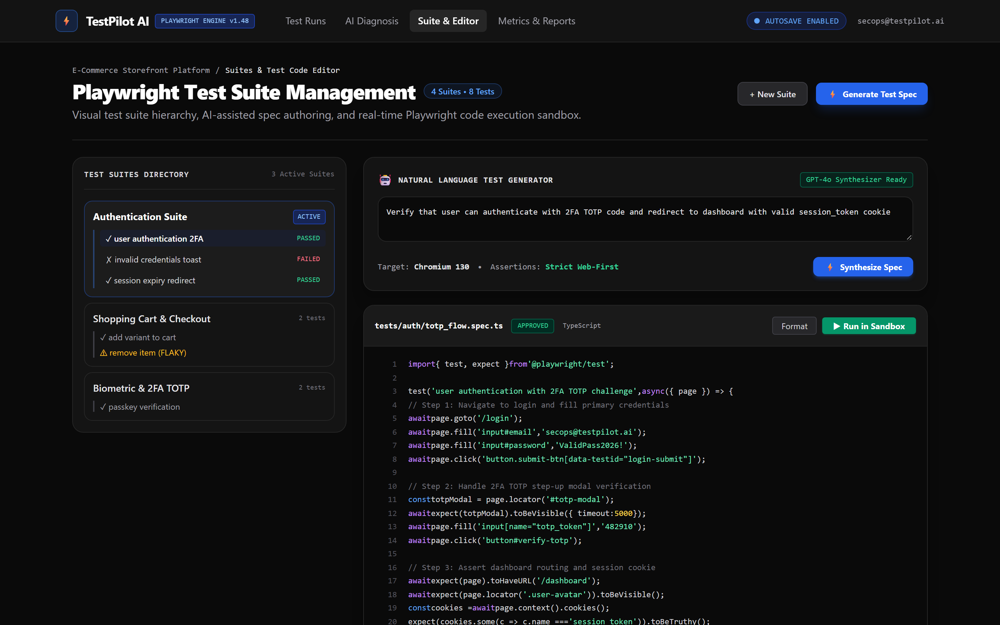
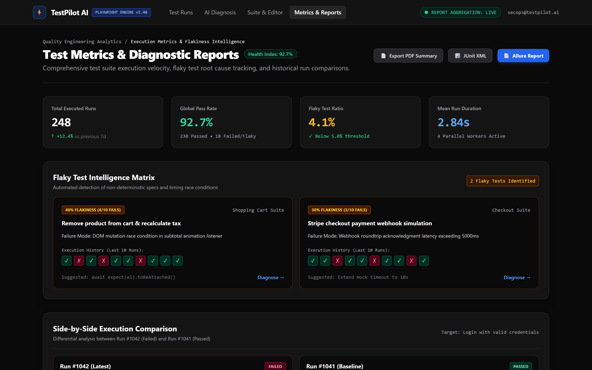

# TestPilot AI

AI-powered Playwright testing platform with failure diagnosis.

Repository: https://github.com/0xyz-exe/testpilot-ai

## Screenshots

### Test Execution & Run Overview


### AI Root-Cause Failure Diagnosis


### Playwright Test Suite Management


### Test Metrics & Diagnostic Reports


## Quick Start

### Backend Setup

Run these commands from the repository root (`testpilot-ai`), not from inside
the `backend` directory:

```bash
python -m venv backend\venv
backend\venv\Scripts\activate
python -m pip install -r backend\requirements.txt
python -m backend.init_db
python -m uvicorn backend.main:app --host 0.0.0.0 --port 8001
```

If your terminal is already in `backend`, first return to the repository root:

```powershell
Set-Location ..
```

If `venv` already exists or Python reports a package import error involving
`pydantic_core`, recreate the environment before installing dependencies:

```powershell
deactivate
Remove-Item -Recurse -Force .\backend\venv
python -m venv .\backend\venv
.\backend\venv\Scripts\Activate.ps1
python -m pip install -r .\backend\requirements.txt
```

Backend: http://localhost:8001

### Test

```bash
curl http://localhost:8001/health
```

## Status

**Phase:** Milestone B (Core Implementation)

**Complete:**
- ✅ Requirements & architecture docs
- ✅ Database models
- ✅ Auth (register/login, bcrypt)
- ✅ Project CRUD routes
- ✅ URL validation & SSRF prevention

**Next:**
- Test execution worker
- Frontend React app
- Artifact storage

## Docs

- [PRD](docs/PRD.md)
- [Architecture](docs/ARCHITECTURE.md)
- [Threat Model](docs/THREAT_MODEL.md)

## Note

Python 3.14 has limited package support. Use Python 3.11 or 3.12 for production.
